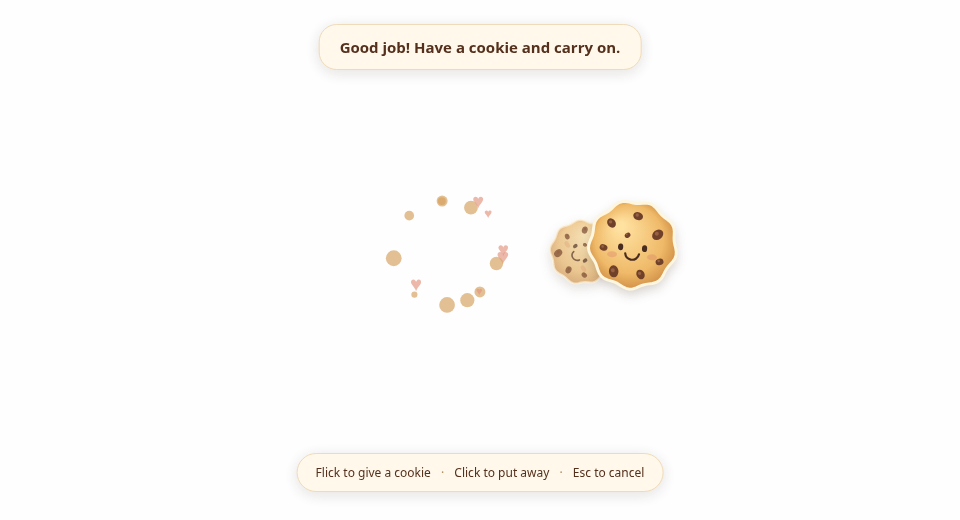
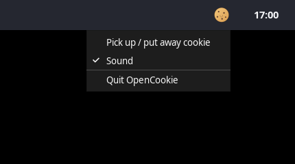

# OpenCookie 🍪

[OpenWhip](https://github.com/GitFrog1111/OpenWhip), but with cookies and encouragement.

Pick up a cookie, flick your mouse, and send a little praise to your coding agent. The cookie follows your cursor, with crumbs, hearts, and a chime when you toss it.



## Install

### Run from source

1. Install [Node.js](https://nodejs.org/en/download/) **22.13 or later**, including npm.
2. Clone this repository or download and unzip it.
3. Open a terminal in the folder containing `package.json`.
4. Install the dependencies and start the app:

```bash
npm ci
npm start
```

The same commands work on Linux, macOS, and Windows. On Windows, use PowerShell or a terminal on the Windows desktop to run the app.

OpenCookie is a **desktop tray app**, so there is no browser page to open. The terminal running `npm start` stays busy while the app runs. Run your coding agent in a separate terminal, or use its chat in your editor.

### Platform requirements

| Platform | What you need |
| --- | --- |
| Linux / Wayland, including Ubuntu's default desktop | XWayland for the overlay, `/usr/bin/python3`, PyGObject, and a desktop with the Remote Desktop portal. Approve keyboard control when prompted. |
| Linux / X11 | `xdotool` for keyboard input. |
| macOS | Accessibility permission for the app in **System Settings → Privacy & Security → Accessibility**. |
| Windows | No separate keyboard utility is needed; input uses the Windows API. |

On Ubuntu or Debian, install the requirements for your session:

```bash
# Wayland
sudo apt install python3-gi xwayland

# X11 instead
sudo apt install xdotool
```

Run `echo "$XDG_SESSION_TYPE"` on Linux if you are unsure which session you use. A desktop tray host is needed to display the cookie icon.

### Use a packaged build

Packaged builds include the runtime, so they do **not** need Node.js or npm. The platform permissions and Linux utilities above still apply.

If you have a build for your operating system:

| Platform | Open the app |
| --- | --- |
| Linux | Make the `.AppImage` executable in its file properties, then double-click it. |
| macOS | Open the `.dmg` and copy OpenCookie to Applications, or extract the supplied `.zip`. |
| Windows | Run the `.exe` installer, or open the portable `.exe` if supplied. |

To create your own packaged build, see [Build and development](#build-and-development). Build each platform's installer on that operating system.

## Give a cookie

1. **Start OpenCookie.** Run `npm start` or open the packaged app.
2. **Allow keyboard control if prompted.** On Wayland, a five-second countdown follows permission approval. Other launches show a three-second countdown.
3. **Click your agent's input during the countdown.** Choose the terminal running Codex or Claude Code, or the empty message box in your editor's agent chat. Clicks pass through the countdown to the application underneath.
4. **Wait for the cookie to appear beside your cursor.** The first cookie is ready to use; there is no extra setup cookie to dismiss.
5. **Flick your mouse.** A quick sweep of roughly 150–250 pixels sends praise. Moving slowly only moves the cookie.

Example message: “Good job! Have a cookie and carry on.”

Each gift has a short cooldown. Input is blocked during the countdown, and movement during setup is never replayed as a gift.

### Controls

| Action | Result |
| --- | --- |
| Flick the mouse while holding a cookie | Toss a cookie and send praise. |
| Click anywhere while holding a cookie | Put the cookie away. This does not quit the app. |
| Press Escape | Put the cookie away, or cancel the countdown. |
| Click the tray cookie | Pick up or put away a cookie; some desktops open its menu first. |
| Select **Sound** in the tray menu | Turn the chime on or off. |
| Select **Quit OpenCookie** in the tray menu | Exit the app and close its keyboard-control session. |

### Get the cookie back

**Click the cookie icon in your system tray or top bar. You do not need to stop or restart OpenCookie.** Focus your agent's input before picking it up again.


If clicking the icon opens a menu, select **Pick up / put away cookie**. The same menu contains **Sound** and **Quit OpenCookie**; it is usually available with a right-click.



*These are screenshots of the actual app in a clean Linux desktop session. Tray placement and menu appearance depend on your desktop: commonly the top bar on Linux, the menu bar on macOS, and the notification area on Windows.*

If your desktop hides the tray icon, run this in **another terminal** in the project folder:

```bash
npm start -- --show
```

It asks the existing instance to show a cookie, with time to focus your agent. It does not start a second copy or restart the existing process. If a cookie is already visible, it stays visible.

To start quietly in the tray without showing a cookie immediately:

```bash
npm start -- --tray
```

### Use it with the VS Code Codex chat

Click **inside the empty Codex message box**, so the text cursor is visible, before the countdown ends or before picking up another cookie. Merely selecting VS Code or hovering over the chat does not focus that input.

OpenCookie types into the focused control. It does not connect directly to the extension, identify an agent, or select a chat under the mouse. Use **Enter to send** in the chat's composer settings if you want the default macro to submit the message. The extension may queue a message while the agent is working.

Once the cookie is visible, clicking puts it away; it does not select an input underneath. Dismiss the cookie first if you need to change the target.

## What the cookie actually does

Like OpenWhip, a toss sends **Ctrl+C → a short praise message → Enter**. In a terminal, Ctrl+C interrupts the current response. In an editor chat, the same shortcut follows that application's behavior; it is not a dedicated command to stop the agent.

On Windows, macOS, and X11, OpenCookie remembers the active application and checks focus during delivery. Wayland does not expose other applications' window IDs for targeting, so input goes to whichever application currently has keyboard focus. Keep the intended agent input active while using the cookie.

This works through keyboard input for Codex and Claude Code. There are no agent hooks, accounts, API keys, or configuration changes. The praise is conversational feedback, not reinforcement learning or a change to model weights.

OpenCookie has no database, feedback queue, telemetry, or dashboard. On Wayland it requests keyboard access through the [desktop portal](https://flatpak.github.io/xdg-desktop-portal/docs/doc-org.freedesktop.portal.RemoteDesktop.html); it does not request screen capture or clipboard access.

## Troubleshooting

| What you see | What to do |
| --- | --- |
| The cookie disappeared after a click | Click the tray cookie again. Dismissing it keeps the app running. |
| No tray icon | Check your desktop's hidden icons/app indicators, or use `npm start -- --show` from another terminal. |
| The cookie animates, but the agent receives nothing | Focus the actual terminal prompt or empty chat message box before picking it up. Check the on-screen message and `OpenCookie:` lines in the launch terminal. |
| Keyboard permission was cancelled or revoked | Dismiss the cookie, pick it up again, and allow keyboard control when prompted. |
| `This setup cookie cannot send praise` | An older version is still running. Quit it from the tray or its launch terminal, then start the updated version. |
| `xdotool` or `python3-gi` is missing | Install the utility listed for your Linux session under [Platform requirements](#platform-requirements). |
| Text appears but is not submitted | Check whether the chat uses Enter to send. A different submit shortcut is not handled by the default macro. |
| `GetVSyncParametersIfAvailable() failed` | This is Chromium graphics-timing output. If the cookie animates normally, use the OpenCookie messages to investigate delivery. Chromium has a [timing fallback](https://chromium.googlesource.com/chromium/src/+/refs/heads/main/ui/gl/gl_surface_presentation_helper.cc). |

`praise keyboard sequence completed` means the operating system accepted the keyboard commands. It does not confirm that an agent received or acted on the message.

**After updating the source or app:** quit the existing OpenCookie instance before launching the new version. A second launch normally talks to the already-running copy, which would keep using its old code.

## Build and development

Install dependencies with `npm ci` first. To create a local desktop build:

```bash
npm run package  # Unpacked application in release/
npm run dist     # AppImage on Linux; DMG/ZIP on macOS; installer/portable EXE on Windows
```

To run checks:

```bash
npx playwright install chromium
npm run check
```

Additional desktop checks:

```bash
npm run test:desktop          # Electron overlay with keyboard delivery disabled
npm run test:portal           # Wayland protocol on a private fake D-Bus portal
npm run test:wayland-desktop  # First-cookie flow, countdown clicks, and cancellation
```

Desktop tests need a graphical session, or Xvfb on Linux. The Wayland tests need Linux, `python3-gi`, and D-Bus; the desktop flow test also needs `xdotool`. `OPENCOOKIE_CHROME` can select an installed Chromium/Chrome executable, and `OPENCOOKIE_PACKAGED_EXECUTABLE` can select an unpacked app for desktop checks.

Validation covers gestures, keyboard commands, browser rendering, Electron startup, and real keyboard delivery to a controlled window in a virtual X11 desktop. Wayland tests use a private fake portal to check approval, the first usable cookie, countdown click-through, cancellation, and revocation. Windows and macOS have unit coverage but have not yet been tested on those operating systems. Behavior in a particular chat application still depends on its focus and keyboard shortcuts.

## Credits

Inspired by OpenWhip's [main process](https://github.com/GitFrog1111/OpenWhip/blob/main/main.js) and [cursor overlay](https://github.com/GitFrog1111/OpenWhip/blob/main/overlay.html). Cookie artwork, animation, and chime are generated locally by OpenCookie.

[MIT License](LICENSE).
